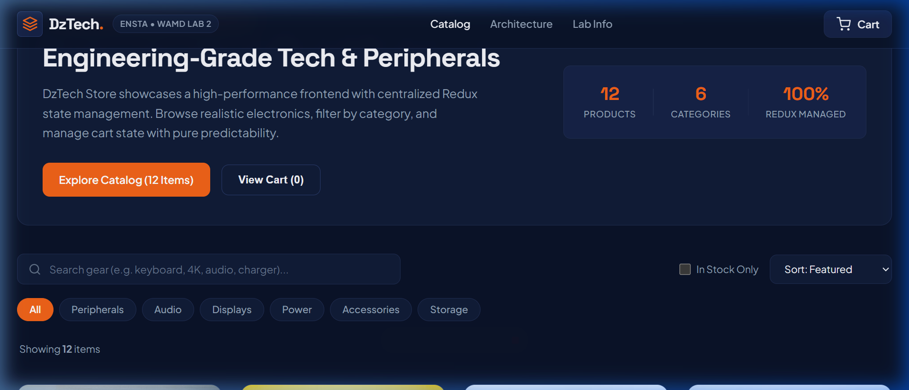
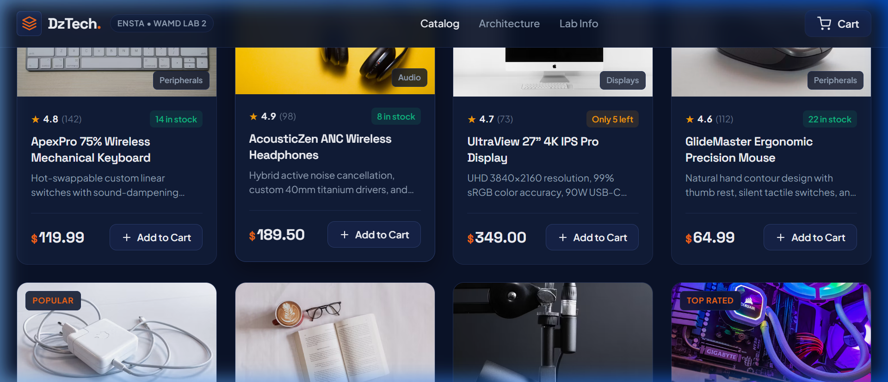
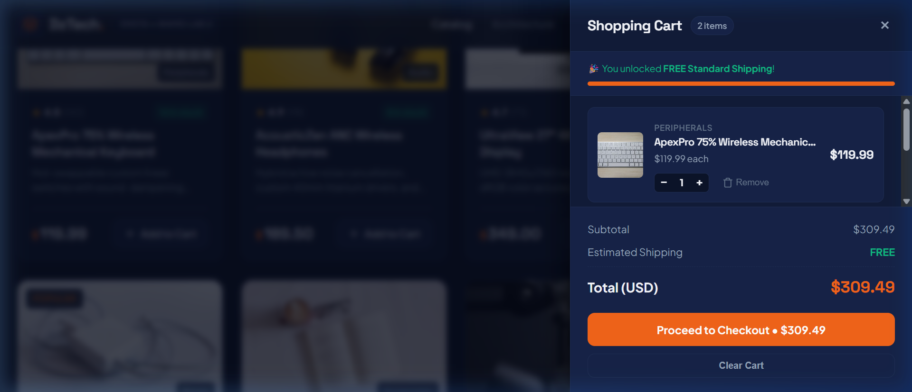
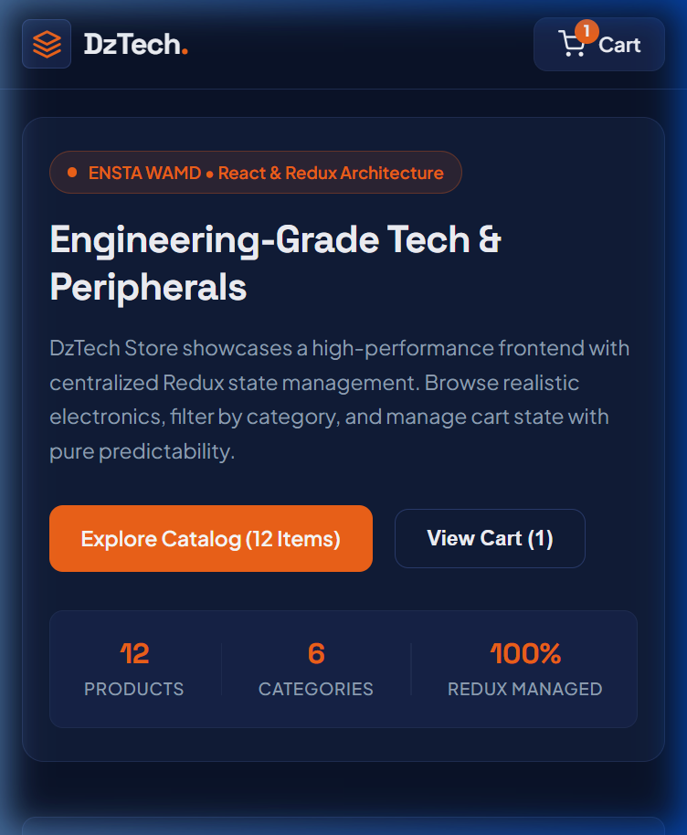

# DzTech Store - React & Redux E-Commerce Frontend

**Academic Lab:** ENSTA • Module WAMD (Web and Mobile Development)  
**TD-TP 2:** Create a React Application with Redux for State Management  
**Student Name:** Anes Benrahmoune  

---

## 1. Store Overview
**DzTech Store** is a responsive e-commerce web application built with React and Redux Toolkit. It showcases how to transition from local component state to predictable, centralized global state management when multiple components depend on shared data (such as the shopping cart, item counts, and totals).

The store features 12 realistic electronics and computing peripherals with category filtering, real-time search, price and rating sorting, stock management, and an interactive slide-over cart drawer with persistent storage.

---

## 2. Technologies Used
- **React 18** (Vite build tool)
- **Redux Toolkit** (`configureStore`) & **react-redux** (`Provider`, `useSelector`, `useDispatch`)
- **JavaScript ES6+** (Modules, arrow functions, destructuring, spread syntax)
- **Vanilla CSS3** (Custom design tokens, Flexbox, CSS Grid, mobile-responsive media queries)
- **Google Fonts** (Space Grotesk for headings, Plus Jakarta Sans for body text)

---

## 3. Main React Components

| Component | File Path | Role |
| :--- | :--- | :--- |
| **Navbar** | `src/components/Navbar.jsx` | Renders branding, navigation links, and dynamic cart badge linked to Redux `totalQuantity`. |
| **FilterBar** | `src/components/FilterBar.jsx` | Manages live search input, category tab pills, price/rating sorting, and in-stock toggle. |
| **ProductList** | `src/components/ProductList.jsx` | Renders the responsive grid of products or an empty state when filters return no matches. |
| **ProductCard** | `src/components/ProductCard.jsx` | Displays item media, category, price, rating, stock status, and dispatches `addToCart`. |
| **CartDrawer** | `src/components/CartDrawer.jsx` | Slide-over panel presenting cart items, free shipping meter, order totals, and checkout flow. |
| **CartItem** | `src/components/CartItem.jsx` | Displays individual cart item row with quantity stepper (`+`/`-`), line total, and remove button. |
| **Toast** | `src/components/Toast.jsx` | Lightweight non-intrusive notification confirming cart additions and user actions. |
| **Footer** | `src/components/Footer.jsx` | Provides academic metadata, ENSTA WAMD module info, and architectural summary. |

---

## 4. Redux State Architecture

### Why Redux was chosen for the Cart
In this application, cart data is shared across multiple sibling and nested components:
1. `Navbar` needs `totalQuantity` to render the badge in the navigation bar.
2. `ProductCard` reads the cart state to disable the add button once an item reaches its maximum stock limit.
3. `CartDrawer` needs the complete array of items to calculate subtotals, free shipping eligibility, and order grand totals.

By storing the cart state in a centralized Redux store, we avoid props drilling and keep state transitions pure, predictable, and traceable.

### State Shape
```javascript
{
  cart: {
    items: [
      {
        id: 1,
        name: "ApexPro 75% Wireless Mechanical Keyboard",
        category: "Peripherals",
        price: 119.99,
        quantity: 2,
        stock: 14,
        image: "..."
      }
    ],
    totalQuantity: 2,
    totalAmount: 239.98
  }
}
```

### Action Types (`src/redux/actionTypes.js`)
- `cart/ADD_TO_CART`: Adds a product to the cart or increments its quantity if already present.
- `cart/REMOVE_FROM_CART`: Removes a product completely from the cart by its ID.
- `cart/INCREASE_QUANTITY`: Increments an item's quantity by 1, respecting available stock.
- `cart/DECREASE_QUANTITY`: Decrements an item's quantity by 1, removing it if the count drops to 0.
- `cart/CLEAR_CART`: Resets the cart to an empty state.

### Action Creators (`src/redux/cartActions.js`)
- `addToCart(product)`
- `removeFromCart(productId)`
- `increaseQuantity(productId)`
- `decreaseQuantity(productId)`
- `clearCart()`

### Reducer Behavior (`src/redux/cartReducer.js`)
The reducer is a pure function following the standard `(state = initialState, action) => newState` pattern. It handles immutable state updates with spread operators and helper calculations for `totalQuantity` and `totalAmount`. Initial cart state is loaded from `localStorage` if available.

---

## 5. Features Implemented

### Required Features
- [x] Product catalog with realistic product cards (image, title, category, price, rating, stock).
- [x] Shopping cart with dynamic quantity updates and price calculations.
- [x] Add to cart and remove from cart functionality.
- [x] Real-time UI updates across components (e.g. Navbar badge, CartDrawer summary).
- [x] Explicit Redux architecture: `configureStore`, pure `cartReducer` with `switch/case`, action creators, and hooks (`useSelector`, `useDispatch`).
- [x] Fully responsive layout on desktop and mobile screens.

### Optional & Advanced Features
- [x] **Quantity Management**: Incremental `+` and `-` steppers with stock limit checks.
- [x] **Dynamic Search**: Instant filtering by product name, description, or category.
- [x] **Category Pills**: Filter by Peripherals, Audio, Displays, Power, Accessories, and Storage.
- [x] **Sorting**: Sort by Featured, Price (Low to High), Price (High to Low), or Top Rated.
- [x] **In-Stock Filter**: Toggle to display only items currently in stock.
- [x] **Free Shipping Meter**: Visual threshold meter (free shipping unlocked over $150).
- [x] **Persistent Cart**: Synchronized with `localStorage` so items survive page reloads.
- [x] **Checkout Simulation**: Interactive checkout workflow with success confirmation.
- [x] **Toast Notifications**: Snappy visual feedback when adding items.

---

## 6. How to Run the Application

### Prerequisites
- Node.js (version 18 or newer)
- npm (version 9 or newer)

### Installation & Launch
1. Clone or navigate to the project directory:
   ```bash
   cd tp2-reactecommerse
   ```

2. Install dependencies:
   ```bash
   npm install
   ```

3. Start the Vite local development server:
   ```bash
   npm run dev
   ```

4. Open your browser and navigate to:
   ```
   http://localhost:5173/
   ```

5. Build for production (optional verification):
   ```bash
   npm run build
   ```

---

## 7. Screenshots

### 1. Catalog & Hero Section (Desktop)


### 2. Product Grid & Filter Bar


### 3. Shopping Cart Drawer (With Items & Totals)


### 4. Responsive Mobile View

